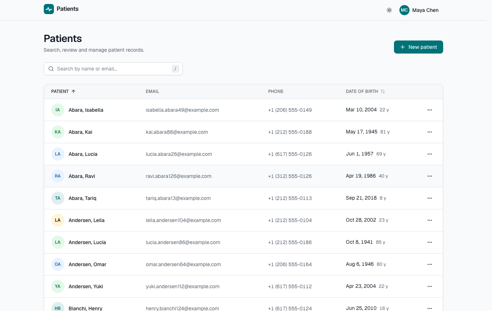
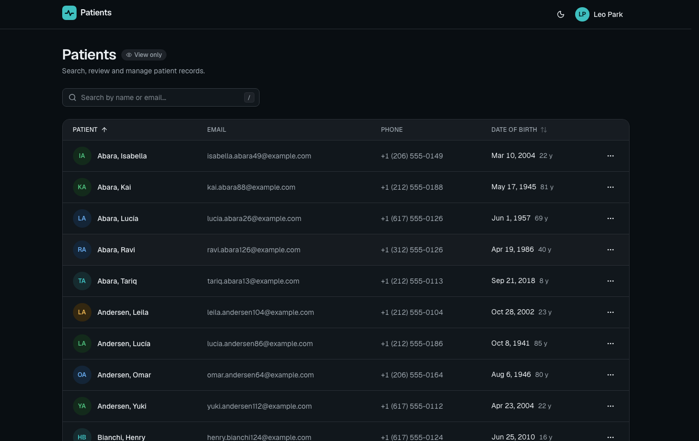
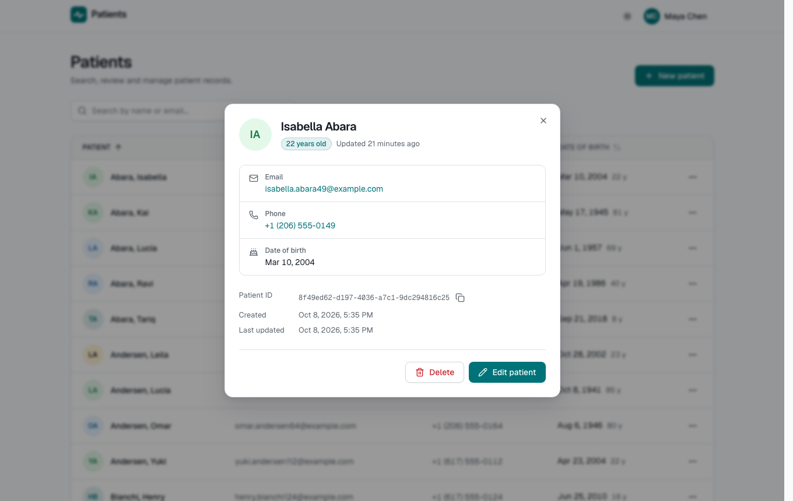
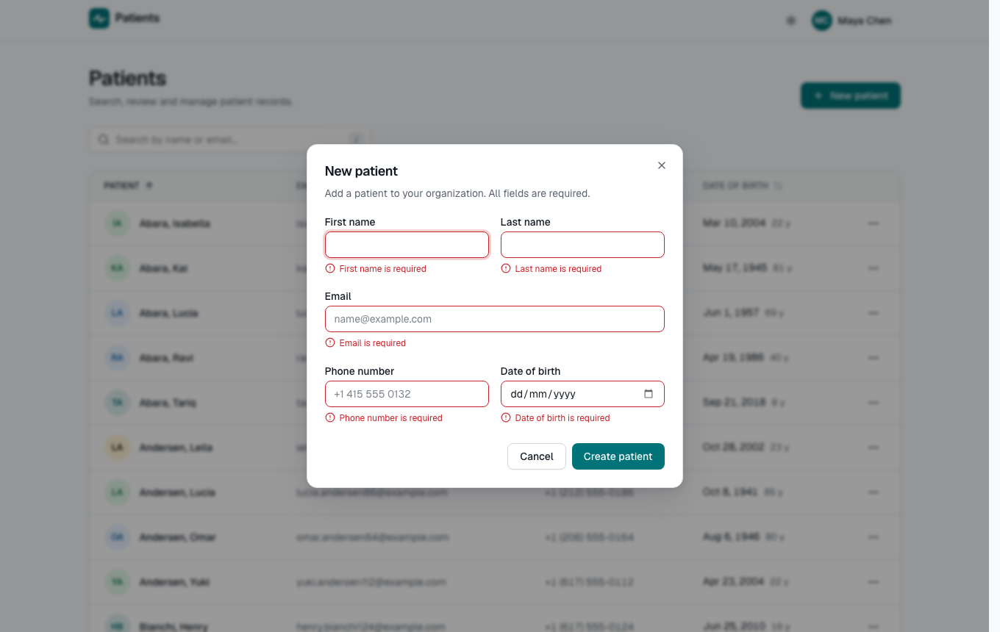
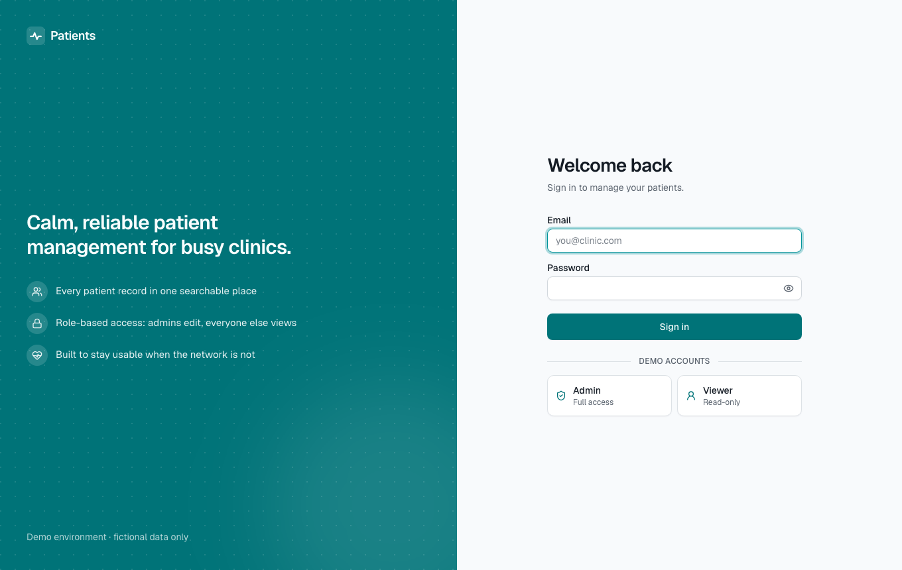
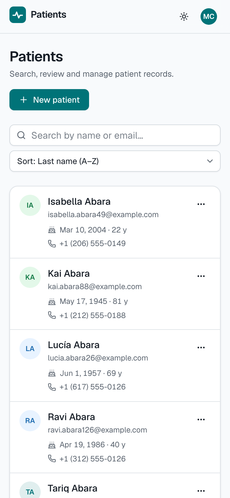

# Patients Management

A role-aware patient records system: **Next.js 16** web app (with a Backend-for-Frontend),
**NestJS 11** API, **PostgreSQL 17** via **Prisma**, in a typed pnpm/Turborepo monorepo
that shares one runtime-validated API contract between both tiers.

**Live demo:** https://patients-management-five.vercel.app (sign in with a [demo account](#quick-start-with-docker))
· API docs: https://patients-management-api.vercel.app/docs

<p align="center">
  
  
</p>

<details>
<summary>More screenshots: details modal · form validation · login · mobile</summary>
<p align="center">
  
  
  
  
</p>
</details>

---

## Contents

- [Quick start with Docker](#quick-start-with-docker) — one command, nothing else to install
- [Local development](#local-development) — backend and frontend on your machine
- [Testing](#testing) · [What's inside](#whats-inside) · [Architecture](#architecture-at-a-glance) ·
  [Key decisions](#key-decisions) · [Configuration](#configuration) · [Troubleshooting](#troubleshooting)

## Quick start with Docker

**You need:** [Docker Desktop](https://www.docker.com/products/docker-desktop/) (or Docker Engine
with the Compose v2 plugin) running, and ports `3000`, `3001` and `5432` free.

```bash
# 1. Clone
git clone https://github.com/joaquingirardi/patients-management.git
cd patients-management

# 2. Build and start everything (first run: ~2–4 minutes to build the images)
docker compose up --build
```

The stack starts in dependency order behind health checks, so there is nothing to wait for by
hand: PostgreSQL → migrations + demo data → API → web. It is ready when the log shows
`web-1 | ✓ Ready`. Then:

| Open                         | What                                                           |
| ---------------------------- | -------------------------------------------------------------- |
| **http://localhost:3000**    | the application                                                |
| http://localhost:3001/docs   | interactive API docs (Swagger UI, generated from the contract) |
| http://localhost:3001/health | API readiness probe                                            |

Sign in with a demo account (locally, the login page also has one-click buttons for them):

| Role                | Email                  | Password       | Can                                |
| ------------------- | ---------------------- | -------------- | ---------------------------------- |
| Admin               | `admin@northwind.test` | `Password123!` | view, create, edit, delete         |
| User (viewer)       | `user@northwind.test`  | `Password123!` | view only                          |
| Admin, other tenant | `admin@contoso.test`   | `Password123!` | sees a _different_ set of patients |

Chaos mode is on in this demo: every database query gets random latency and a 15 % chance
of failing. Watch the API absorb it with `docker compose logs -f api`. Run
without it: `CHAOS_ENABLED=false docker compose up`.

Stop with `Ctrl+C` (or `docker compose down`). `docker compose down --volumes` also deletes the
database, so the next start re-creates the demo data from scratch.

## Local development

Run the backend and frontend directly on your machine (hot reload, debugger, faster tests).
PostgreSQL still runs in Docker so nobody has to install it.

### Prerequisites

| Tool    | Version    | How to get it                                                                    |
| ------- | ---------- | -------------------------------------------------------------------------------- |
| Node.js | ≥ 22.12    | [nodejs.org](https://nodejs.org) or `nvm install` (reads `.nvmrc`)               |
| pnpm    | 10         | `corepack enable` (ships with Node; picks the exact version from `package.json`) |
| Docker  | any recent | for PostgreSQL and the integration tests                                         |

### Steps

```bash
# 1. Clone and install (also generates the Prisma client and installs git hooks)
git clone https://github.com/joaquingirardi/patients-management.git
cd patients-management
corepack enable
pnpm install

# 2. Environment files (the defaults work as-is with step 3)
cp apps/api/.env.example apps/api/.env
cp apps/web/.env.example apps/web/.env.local

# 3. Database: PostgreSQL 17 in Docker on localhost:5432, then schema + demo data
pnpm db:up
pnpm db:migrate
pnpm db:seed

# 4. Run backend + frontend together (watch mode)
pnpm dev
```

Open **http://localhost:3000** and sign in with a demo account above. The API runs on
http://localhost:3001 (docs at `/docs`).

**Backend and frontend separately** (e.g. in two terminals, after steps 1–3):

```bash
pnpm --filter @pm/contracts build   # shared contract package, needed once (pnpm dev watches it)
pnpm --filter @pm/api dev           # backend  → http://localhost:3001
pnpm --filter @pm/web dev           # frontend → http://localhost:3000
```

**Check that everything works:** `pnpm verify` (format, lint, typecheck, unit tests; about a
minute) and `pnpm test:integration` (API against a disposable PostgreSQL; Docker must be running).

### Everyday commands

| Command                           | Does                                                                   |
| --------------------------------- | ---------------------------------------------------------------------- |
| `pnpm dev`                        | contracts (watch) + API + web with hot reload                          |
| `pnpm verify`                     | Prettier check, ESLint, strict typecheck, unit/component tests         |
| `pnpm test:integration`           | API integration tests (Testcontainers PostgreSQL)                      |
| `pnpm test:e2e`                   | Playwright + axe against a running stack (see [Testing](#testing))     |
| `pnpm test:cov`                   | coverage reports (`apps/*/coverage/`), with enforced thresholds        |
| `pnpm db:migrate`                 | apply / create migrations (`--name <change>` after editing the schema) |
| `pnpm db:seed`                    | (re)load demo data, idempotent                                         |
| `pnpm db:reset`                   | drop and rebuild the **local** database, then seed                     |
| `pnpm --filter @pm/api db:studio` | browse the database in Prisma Studio                                   |
| `pnpm build`                      | production builds of all packages                                      |

## Testing

| Command                 | What it proves                                                                                                                                                                                                      | Tests |
| ----------------------- | ------------------------------------------------------------------------------------------------------------------------------------------------------------------------------------------------------------------- | ----- |
| `pnpm verify`           | Prettier, ESLint (type-aware, strict, jsx-a11y), `tsc --strict`, unit + component tests (incl. BFF CSRF/allowlist, route protection, session expiry)                                                                | 120   |
| `pnpm test:integration` | The real HTTP stack against real PostgreSQL 17 (Testcontainers): auth, RBAC, tenant isolation, validation, concurrency races, soft delete, rate limiting under spoofed IPs, chaos retries, 503 degradation, OpenAPI | 46    |
| `pnpm test:e2e`         | Browser journeys + **axe WCAG 2.1 AA** scans in light & dark, desktop & mobile                                                                                                                                      | 22    |

Coverage (`pnpm test:cov`): **API 97 % of lines** (unit + integration), web 72 % in unit tests,
with the remaining UI shell exercised by Playwright. Thresholds fail the build if coverage drops.

End-to-end tests need the stack running, deterministic (no chaos) and with a relaxed login
limit, plus a browser installed once:

```bash
CHAOS_ENABLED=false THROTTLE_LOGIN_LIMIT=1000 docker compose up --build --detach --wait
pnpm --filter @pm/web exec playwright install chromium
pnpm test:e2e
```

Test layers are chosen by what can break: pure rules → unit; SQL, guards and status codes →
integration (no mocked database); UI behaviour incl. optimistic rollback → component tests with an
in-memory MSW API; cross-tier journeys and accessibility → Playwright.

## What's inside

| Requirement           | Implementation highlights                                                                                                                                                                                                                                                |
| --------------------- | ------------------------------------------------------------------------------------------------------------------------------------------------------------------------------------------------------------------------------------------------------------------------ |
| **Auth (role-aware)** | JWT with `role` claim, bcrypt, 30-min expiry; token kept in an **httpOnly cookie** by the BFF (never readable by JS); route protection at the edge; proactive expiry warning + reactive 401 handling; open-redirect-safe `?next=`                                        |
| **RBAC**              | Deny-by-default guards (401 → 403), one permission map shared by API and UI, service-level checks, **tenant-scoped repositories** (cross-tenant = 404)                                                                                                                   |
| **Patients list**     | Server-side search (multi-term, trigram-indexed), sort, pagination — all **URL-synced**; skeletons, empty, error (with request id), stale-while-error states; next-page & hover prefetch                                                                                 |
| **Create / edit**     | Same Zod schema on client and server; human input normalised (E.164 phones, lower-case emails); **optimistic create/update/delete with rollback** and one-click retry; **version-based conflict detection**                                                              |
| **Details**           | Intercepting route: modal over the list, full page on reload/deep link                                                                                                                                                                                                   |
| **Design**            | Semantic OKLCH tokens (primary/success/warning/destructive/info/neutral), type/space/radius/elevation/motion scales, light + dark, reduced motion, table → cards on phones                                                                                               |
| **API**               | REST per the contract; **OpenAPI/Swagger at `/docs` generated from the contract**; RFC 9457 Problem Details with stable codes; request ids; structured PHI-safe logs; `Cache-Control: no-store` for patient data; rate limiting; Helmet; validated config; health probes |
| **Performance**       | Route-level splitting plus write-only UI lazy-loaded for admins only; layout-matched skeletons; previous page kept (dimmed) while the next loads; next-page and hover prefetch; trigram/composite indexes                                                                |
| **Resilience**        | Fault injection at the **database boundary**, retry-safety classification (reads vs writes), jittered backoff, 503 + `Retry-After`; client retries GETs only                                                                                                             |
| **Data**              | Organizations/users/patients with FKs, CHECK constraints, soft delete, audit columns, optimistic-lock `version`, composite + GIN indexes                                                                                                                                 |
| **DX**                | Strict TS, shared ESLint/TS presets, Prettier + lint-staged hooks, Turborepo pipeline, CI (quality, integration, e2e), Dependabot, multi-stage non-root images                                                                                                           |

## Architecture at a glance

```
browser ──► Next.js (UI + BFF: cookie→Bearer, CSRF, allowlist) ──► NestJS API ──► PostgreSQL
                │                                                     │
                └──────────────  @pm/contracts (Zod)  ────────────────┘
```

```
apps/
  api/        NestJS: config · common (errors, validation, logging) · database (resilience) · auth · users · patients · health
  web/        Next.js: app (routes + BFF) · features (auth, patients) · components/ui (design system) · lib
packages/
  contracts/  Zod schemas, inferred types, roles, permissions, error codes — shared by both apps
  tsconfig/   strict compiler presets          eslint-config/  type-aware lint presets
docs/         architecture · API reference · ADRs · scope & prioritisation · deployment
.claude/      Claude Code agents, skills and settings for working on this repo
```

Read next:

- [Architecture](docs/architecture.md): diagrams, request lifecycle, layering, data model, design tokens
- [API reference](docs/api.md): endpoints, parameters, error codes, examples
- [Architecture Decision Records](docs/adr/README.md): the reasoning behind the non-obvious choices
- [Scope & prioritisation](docs/prioritization.md): what got depth, what was cut, and why
- [Deployment](docs/deployment.md): running the images on any container platform

## Key decisions

1. Request and response shapes are one set of Zod schemas, validated at runtime by both the form and the API. ([0001](docs/adr/0001-monorepo-with-shared-contracts.md))
2. The browser never sees the access token. The BFF keeps it in an httpOnly cookie and the API stays the only authority. ([0002](docs/adr/0002-bff-session-with-httponly-cookie.md))
3. Authorization is enforced in data access: a repository query without a tenant scope does not compile. ([0003](docs/adr/0003-authorization-as-data-access.md))
4. Resilience sits at the database boundary, where failures actually happen, and writes are never retried blindly. ([0004](docs/adr/0004-resilience-at-the-dependency-edge.md))
5. Optimistic UI is paired with a `version` column, so concurrent edits are rejected instead of silently overwriting each other. ([0005](docs/adr/0005-concurrency-and-optimistic-ui.md))
6. Patients use soft delete, a non-unique email, a date-only date of birth and E.164 phone numbers. ([0006](docs/adr/0006-patient-data-modelling.md))

## Configuration

API (`apps/api/.env.example` documents all of them; validated at boot):

| Variable                      | Default                 | Purpose                                                      |
| ----------------------------- | ----------------------- | ------------------------------------------------------------ |
| `DATABASE_URL`                | —                       | PostgreSQL connection string                                 |
| `JWT_SECRET`                  | —                       | HS256 secret, ≥ 32 chars                                     |
| `JWT_TTL_SECONDS`             | `1800`                  | token lifetime                                               |
| `CORS_ORIGINS`                | `http://localhost:3000` | comma-separated                                              |
| `THROTTLE_LOGIN_LIMIT`        | `10`                    | login attempts per minute, per client IP **and** per account |
| `API_DOCS_ENABLED`            | on outside production   | Swagger UI at `/docs`, OpenAPI JSON at `/docs/openapi.json`  |
| `TRUST_PROXY_HOPS`            | `1`                     | proxy hops whose `X-Forwarded-For` is trusted (the web BFF)  |
| `CHAOS_ENABLED`               | `false`                 | simulate a flaky database                                    |
| `CHAOS_FAILURE_RATE`          | `0.15`                  | per-query failure probability                                |
| `CHAOS_LATENCY_MIN_MS/MAX_MS` | `50` / `500`            | per-query injected latency                                   |
| `DB_RETRY_MAX_ATTEMPTS`       | `3`                     | `1` disables server retries (shows client-side resilience)   |

Migrator: `SEED_DEMO_DATA=true` loads the demo accounts (Compose only).
Web: `API_URL` (server-side only), `DEMO_ACCOUNTS` (one-click demo sign-in; on in dev and Compose, off in production builds), `SESSION_COOKIE_SECURE` (defaults to `true` in production),
`TRUSTED_PROXY_HOPS` (load balancers in front of the web app; default `0`).

## Fixed in self-review

Bugs I found while reviewing my own work before hand-off, each fixed with a regression test: an
open redirect via control characters in `?next=`, a login rate-limit bypass through a spoofed
`X-Forwarded-For`, a conflict "Review" loop that reused a cached stale version, concurrent
optimistic mutations undoing each other, and a mid-flight write failure that invited duplicate
creates.

## Hosting

Both tiers run on Vercel: the web app at https://patients-management-five.vercel.app and the API
at https://patients-management-api.vercel.app, against a managed PostgreSQL (Supabase). Chaos mode
is on there too, so expect the occasional retry or failure toast. Setup details are in
[docs/deployment.md](docs/deployment.md#vercel). The Docker images are production-shaped as well
(multi-stage, non-root, tini, health checks, migration job separate from the runtime) and the same
document covers running them on ECS, Cloud Run, Fly, Render or Kubernetes.

## Troubleshooting

| Symptom                                            | Fix                                                                                                                                                                                                                                            |
| -------------------------------------------------- | ---------------------------------------------------------------------------------------------------------------------------------------------------------------------------------------------------------------------------------------------- |
| `port is already allocated` / `EADDRINUSE`         | Something else uses 3000/3001/5432. Docker: `WEB_PORT=3100 API_PORT=3101 POSTGRES_PORT=5433 docker compose up`. Local: stop the other process, or run `POSTGRES_PORT=5433 pnpm db:up` and change the port in `apps/api/.env`'s `DATABASE_URL`. |
| API exits with `Invalid environment configuration` | `apps/api/.env` is missing or incomplete; copy it from `.env.example` (the message names the variable).                                                                                                                                        |
| `Can't reach database server`                      | `pnpm db:up` was not run, or Docker is not running.                                                                                                                                                                                            |
| Integration tests fail to start a container        | Docker must be running; or point `TEST_DATABASE_URL` at a disposable database.                                                                                                                                                                 |
| "Too many attempts" on login while testing         | The limit is 10/min per IP and per account — wait a minute or raise `THROTTLE_LOGIN_LIMIT`.                                                                                                                                                    |
| `pnpm: command not found`                          | Run `corepack enable` (Node ≥ 22.12 ships Corepack).                                                                                                                                                                                           |
| Signed out unexpectedly                            | Sessions last 30 minutes by design (`JWT_TTL_SECONDS`); you are warned a minute before.                                                                                                                                                        |
