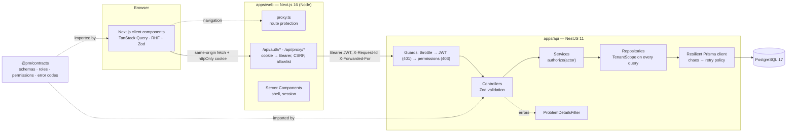
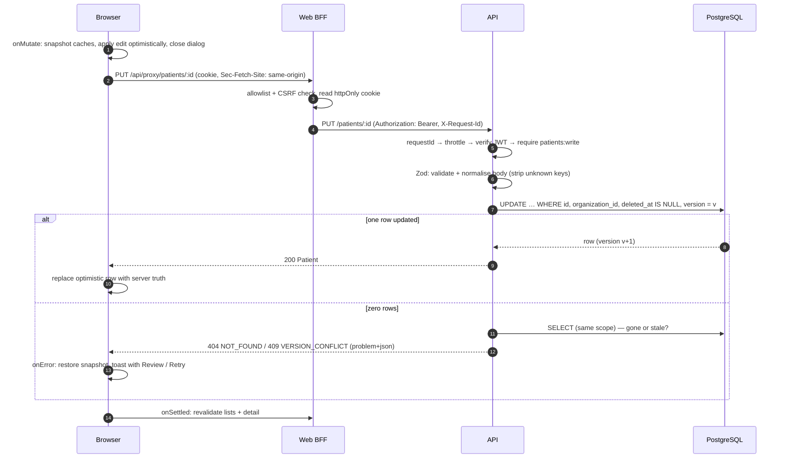
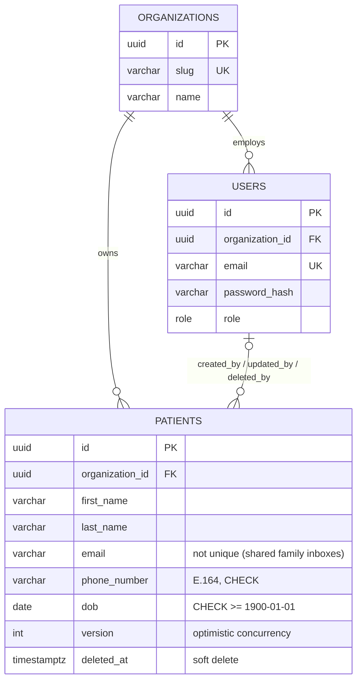

# Architecture

## System overview



**Why this shape:** the browser never holds the token (ADR 0002); authorization is enforced at the
edge _and_ in data access (ADR 0003); the flaky dependency is simulated where real ones live,
behind the repositories (ADR 0004); one contract package keeps both sides honest (ADR 0001).

## Request lifecycle — `PUT /patients/:id`



## Backend layout (`apps/api/src`)

```
config/           Zod-validated environment → typed AppConfig (fail fast at boot)
common/
  errors/         Domain errors + the single ProblemDetailsFilter (RFC 9457)
  http/           cross-cutting HTTP middleware (Cache-Control: no-store for PHI)
  validation/     ZodValidationPipe (shared contract schemas)
  logging/        request-id middleware, pino config (PHI-safe serializers)
database/
  prisma.service  connection lifecycle
  database.ts     DATABASE token: the resilient, extended client repositories use
  resilience/     chaos injection, retry with full jitter, retry-safety classification
  seed.ts         idempotent, deterministic demo data
auth/             login, token issue/verify, global guards, @Public/@RequirePermissions/@CurrentActor
users/            UsersRepository
patients/         dto/ (contract schemas, named) · entities/ (model slice + mapping) ·
                  controller (thin) → service (rules, authz, audit) → repository (tenant-scoped SQL)
openapi/          OpenAPI document generated from @pm/contracts → Swagger UI at /docs
health/           liveness + readiness (raw client: never affected by chaos)
```

Rules of the road:

- **Controllers** parse/validate and delegate. **Services** own business rules and authorization
  and throw domain errors. **Repositories** own queries and require a `TenantScope`.
- Modules are vertical (feature folders). A new resource is a new folder with the same four files.

## Frontend layout (`apps/web/src`)

```
app/                   routes only: layouts, pages, loading/error boundaries, BFF route handlers
  (auth)/login         public
  (app)/patients       authenticated; @modal parallel slot + (.)[id] intercepting route
  api/auth, api/proxy  the BFF
proxy.ts               route protection (Next.js 16 "proxy", formerly middleware)
components/ui          design-system primitives (shadcn/ui style, Radix under the hood)
components/{layout,feedback}
features/
  auth/                session provider, <Can>, login form
  patients/            api · hooks (queries, optimistic mutations) · components · lib (format, URL state)
lib/                   api client + Problem Details, query client policy, session claims, env
test/                  MSW fake API, reactive next/navigation mock, render helpers
```

Features own their data, hooks and components; `app/` stays a thin routing layer; `components/ui`
knows nothing about patients. Dependencies point inward: `app → features → components/lib`.

## Data model



## Design system

Tokens live in [`apps/web/src/app/globals.css`](../apps/web/src/app/globals.css) and are exposed
to Tailwind v4 via `@theme`:

| Layer     | Tokens                                                                                                                                                                                |
| --------- | ------------------------------------------------------------------------------------------------------------------------------------------------------------------------------------- |
| Colour    | semantic only — `background/foreground`, `primary`, `success`, `warning`, `destructive`, `info`, `muted`, each with `-foreground` / `-subtle` pairs; OKLCH, AA contrast, light + dark |
| Type      | Geist Sans/Mono; h1 24→28px tight, body 14–16px relaxed; `tabular-nums` for dates & phones                                                                                            |
| Space     | Tailwind 4px scale; page gutter 16→24px; vertical rhythm in 4/6/8 steps                                                                                                               |
| Radius    | one `--radius` knob → `sm/md/lg/xl`                                                                                                                                                   |
| Elevation | `shadow-xs` controls → `sm` cards → `md` menus → `lg` dialogs, hue-tinted                                                                                                             |
| Motion    | 150–300 ms, ease-out-quart; dialogs scale/fade (sheet on phones); `prefers-reduced-motion` honoured globally                                                                          |

Responsive table: **≥ lg** all columns · **md** email folds under the name, phone hidden ·
**< md** stacked cards with large touch targets and an explicit sort control.
